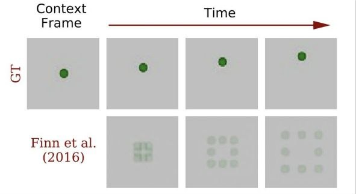

این نوشته را هوش مصنوعی از [کانال تلگرام](https://t.me/roznevesht_parsa_rajaei) به وبلاگ منتقل کرده است و متن آن بدون ویرایش منتشر شده است.

چند وقتی هست که میخواستم کمی از نحوه استفاده خودم از LLMها و اینکه این مدل‌ها چقدر احمق هستند بنویسم‌ قبل از این که غُر زدن درباره این مدل‌ها را شروع کنم باید بگم که من خودم تقریبا هر روز از این مدل‌ها استفاده میکنم و به نظرم ابزارهای بسیار مفیدی می‌توانند باشند.

من در مکالماتم بیشتر تلاش میکنم که جوری سوال بپرسم که آنها مجبور نشوند خودشان استدلال کنند و به من جواب بدهند و به آنها می‌گویم که استدلال‌ها و نظرات مختلف را از مقاله‌ها یا از روی اینترنت نقل کنند. یعنی بیشتر با آنها به شیوه یک رسانه‌ای مثل کتابخانه برخورد میکنم تا یک انسان هوشمند.

جدا از این بحث که اگر استدلال کردن را به آنها برون سپاری کنیم کم کم قدرت استدلال‌مان را از دست میدهیم برای این کار دلیل دیگری هم دارم.

به نظرم نگاه کردن به مدل‌های زبانی به عنوان رسانه دانش (medium of knowledge) نگاه درست‌تری است تا اینکه آنها را به چشم موجودات هوشمند ببینیم. لفظ موجودات هوشمند را خیلی با بی‌دقتی استفاده میکنم چون واقعا میتوانیم درجه‌ای از هوشمندی را برای آنها قائل بشویم.

اگر کمی سوالاتی از آنها بپرسیم که از دامنه اطلاعاتی که روی آن آموزش دیده‌اند فاصله دارد به وضوح جواب‌های مسخره و ابلهانه آنها را میتوانیم ببینیم.
البته این درباره آدم‌ها هم صادق است یعنی آدم‌ها هم درباره موضوعاتی که اطلاعاتی از آن ندارند حرف‌های ابلهانه میزنند. اما در خصوص LLMها به نظرم این موضوع بسیار ملموس‌ است.
در ادامه کمی توضیح میدهم که چرا LLMها بیشتر شبیه خلاصه کننده کتابخانه هستند تا یک انسان متخصص هوشمند.

مدل‌های زبانی شبیه به ماشین‌های میانگین گیری هستند. اگر متنی که در آن دیدگاهای متفاوتی وجود دارد ورودی به آنها بدهیم و نتیجه متن را از آنها بخواهیم خروجی بی‌بخار ترین متن ممکن خواهد بود. برای انتخاب کلمه‌ای مثل بی بخار خیلی فکر کردم اما کلمه‌ی دیگری به نظرم نرسید منظورم از بی‌بخار این است که آنها به ایده‌ای اشتباه نمیگویند و وسط دو ایده را همیشه ترجیح میدهند.
آنها مدلی از جهان ندارند تا صدق و کذب ایده‌ها را تشخیص بدهند و نتیجه‌‌ای را تحویل میدهند که گوشه‌ی تیزی نداشته باشد و تا حد ممکن رقیق شده باشد (واقعا توصیف کردن کار سختی است🤦‍♂️).

باز در رشته‌های سر راستی مثل ریاضی یا برنامه‌ نویسی که روابط خوش تعریف هستند و کل مطلب همان نمادها است این مشکل کمتر وجود دارد. اما خروجی آنها در رشته‌هایی مثل فلسفه یا علوم اجتماعی روح آدم را خراش میدهد.

کمی توصیف با رسم شکل
تصویر بالا خروجی مدل‌های ابتدایی پیشبینی تصویر است. همین طور که میبینید در طول زمان(از سمت چپ به راست) مدل برای پیشبینی تصویر بعد تمامی حالات ممکن را میانگین میگیرد (به قول ما آماری‌ها خاصیت اتورگرسیو) و خروجی به جای اینکه حرکت توپ در یک جهت باشد تصویر بلوری از حرکت توپ در تمامی جهت‌های ممکن است.

به نظر من اگر نتیجه‌ی موضوعی برای ما اهمیت دارد نباید از LLMها بخواهیم که به جای ما فکر کنند و نتیجه را بگویند. کار بهتری که میتوانیم بکنیم این است که به جای اینکه آنها نتیجه میانگین گرفته شده را تحویل ما بدهند اطلاعات خام را از آنها بگیریم و در مدل ذهنی که داریم قرار بدهیم. همان که گفتم بیشتر به چشم کتابخانه به آن نگاه کنیم تا یک انسان  هوشمند.

یک مثال جالب از David Krakauer جدیدا شنیدم که میگفت ما به کسی ‌که برای پاسخ دادن به یک سوال به کتابخانه میرود و انرژی زیادی را صرف پاسخ دادن به سوال میکند باهوش نمیگویم‌.
اگر شما سوالی را سریع و راحت پاسخ بدهید میگویم که باهوش هستید نه اینکه کل انرژی جهان را صرف پاسخ دادن به آن سوال کنید انقدر که برق کم بیارید و به دنبال درست کردن راکتور هسته‌ای بی‌افتید.
هوش هیچ وقت درباره این نبوده که با منابع نامحدود چگونه مسئله را حل میکنید. هوش درباره حل مسئله باوجود محدودیت‌ محاسباتی و اطلاعاتی است و اتفاقا اگر شما تمام منابع ممکن را در اختیار مدل‌ هوش مصنوعی قرار بدهید مدل شما احمق‌تر میشود تا باهوش‌تر.
