---
title: "پادکست‌های پیشنهادی"
date: 2025-07-22T07:19:00+03:30
draft: false
categories:
  - "تصویر بزرگ"
tags:
  - "پادکست"
  - "بهره‌وری"
---

## پادکست‌های تاریخی

**[علوم غیر انسانی](https://castbox.fm/channel/%D8%B9%D9%84%D9%88%D9%85-%D8%BA%DB%8C%D8%B1%E2%80%8C%D8%A7%D9%86%D8%B3%D8%A7%D9%86%DB%8C-id3111331?country=gb)**

پادکست جذابی است و وقایع تاریخی را نه به خاطر خود تاریخ بلکه به خاطر انتقال دادن نمای کلی از جهان نقل می‌کنند.

**[معجون](https://castbox.fm/channel/6662697?country=gb)**

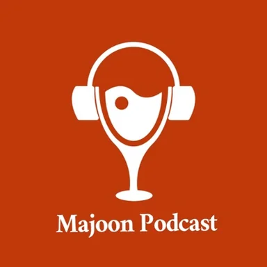

پادکست تاریخی معقولی است. بیشتر به کشورهای سوسیالیستی و نزدیک به شوروی می‌پرداختند ولی جدیداً کمی موضوعات‌شون متنوع‌تر شده.

**[بی‌پلاس](https://bpluspodcast.com/bplus-links/)**

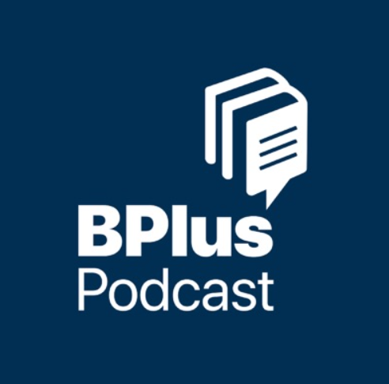

با گوینده‌گی علی بندری — اوایل کتاب‌های خیلی خوبی معرفی می‌کردند اما بعد از تظاهرات مهسا امینی علی بندری شروع کرد به تاریخ تعریف کردن. انصافاً تاریخ را هم قشنگ تعریف می‌کند اما من احساس می‌کنم که برای حفظ جذابیت مطالب از دقت و بی‌طرفی مطلب کم می‌کند.

**[تاریخ شفاهی ایران در دانشگاه هاروارد](https://castbox.fm/channel/%D8%AA%D8%A7%D8%B1%DB%8C%D8%AE-%D8%B4%D9%81%D8%A7%D9%87%DB%8C-%D8%A7%DB%8C%D8%B1%D8%A7%D9%86-id2055067)**

پروژه تاریخ شفاهی پادکست جالبی است. در این پروژه می‌روند و با افراد تاریخ معاصر ایران که هنوز زنده هستند مصاحبه می‌کنند. ضبط‌ها چون عموماً با نوار ضبط شده کیفیت خوبی ندارند. اگر به صحبت‌های شخص خاصی علاقه‌مند هستید گوش بدید. خود من صحبت‌های علی‌نقی عالیخوانی را خیلی دوست داشتم — آقای عالیخوانی از سال ۱۳۴۱ تا ۱۳۴۸ در سال‌های طلایی اقتصاد ایران وزیر اقتصاد بودند.

---

## روانشناسی و توسعه فردی

**[پادکست آذرخش مکری](https://castbox.fm/channel/azarakhshmokri-%7C-%D8%AF%DA%A9%D8%AA%D8%B1-%D8%A2%D8%B0%D8%B1%D8%AE%D8%B4-%D9%85%DA%A9%D8%B1%DB%8C-id4260684)**

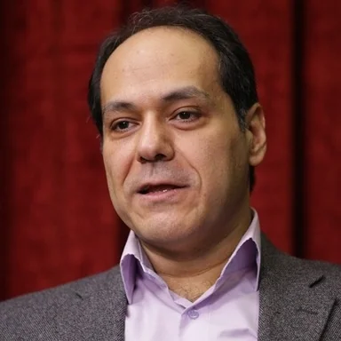

دکتر آذرخش مکری که احتیاج به معرفی ندارند — استاد روانشناسی دانشگاه تهران هستند. بشدت انسان باسواد، متین و خوشفکری هستند.

**[رادیو متمم](https://castbox.fm/channel/%D8%B1%D8%A7%D8%AF%DB%8C%D9%88-%D9%85%D8%AA%D9%85%D9%85-%E2%80%93-%D9%85%D8%AA%D9%85%D9%85-id1635717)**

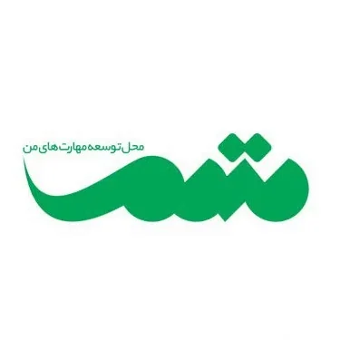

رادیو متمم و سایت متمم متعلق به استاد محمدرضا شعبانعلی است. من از مریدان ایشونم. در متمم و این پادکست به مطالب توسعه فردی و مدیریتی می‌پردازند.

**[رادیو مذاکره محمدرضا شعبانعلی](https://castbox.fm/channel/%D8%B1%D8%A7%D8%AF%DB%8C%D9%88-%D9%85%D8%B0%D8%A7%DA%A9%D8%B1%D9%87-%E2%80%93-%D8%B1%D9%88%D8%B2%D9%86%D9%88%D8%B4%D8%AA%D9%87%E2%80%8C%D9%87%D8%A7%DB%8C-%D9%85%D8%AD%D9%85%D8%AF%D8%B1%D8%B6%D8%A7-%D8%B4%D8%B9%D8%A8%D8%A7%D9%86%D8%B9%D9%84%DB%8C-id6011743)**

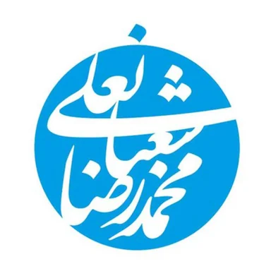

ممکن است مذاکره موضوع بی‌اهمیتی به نظر برسد اما وقتی پای صحبت‌های ایشون می‌شینید می‌توانید نور را از دهان ایشان ببینید که به جهان می‌تابد.

---

## پادکست‌های اقتصادی

می‌رسیم به پادکست‌های اقتصادی. بعضی از این‌ها پادکست‌های حرص‌خوری هستند و در آنها افتضاحات اقتصادی دولت‌مردان عزیز را شرح می‌دهند. اما این قول را می‌توانم به شما بدهم که از جایی به بعد دیگر سِر می‌شوید.

ممکن است که بپرسید که چرا انقدر باید حرص بخوریم که سِر بشویم؟ و من در جواب می‌توانم بگویم که اقتصاد از موضوعاتی است که شاید یکی از گسترده‌ترین و جامع‌ترین دید را از دنیا به آدم می‌دهد. با اقتصاد دیگر بحث‌های سیاسی و اقتصادی بیشتر از اینکه دعوای اعتقادات و تعصبات باشند تبدیل به بحث‌های علمی و قابل پیگیری می‌شوند.

داشتن اطلاعات عمومی از اقتصاد باعث می‌شود اخباری که در تلویزیون می‌گویند برای شما معنی‌دار شود و از یک نویز عقیدتی به مباحث علمی (یا مهملات) تغییر کنند.

**[اقتصاد ایران در گذار از بحران](https://castbox.fm/channel/%D8%A7%D9%82%D8%AA%D8%B5%D8%A7%D8%AF-%D8%A7%DB%8C%D8%B1%D8%A7%D9%86-%D8%AF%D8%B1-%DA%AF%D8%B0%D8%A7%D8%B1-%D8%A7%D8%B2-%D8%A8%D8%AD%D8%B1%D8%A7%D9%86-id3558585)**

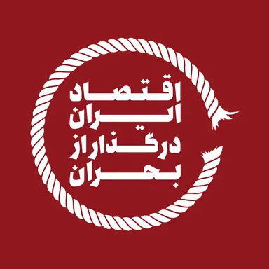

پادکست حرص‌خوری اول. تقریباً اکثر مشکلات اقتصاد ایران را شرح می‌کنند. برای یادگیری اقتصاد پادکست خیلی خوبی است.

**[سواد مالی و اقتصادی](https://castbox.fm/channel/%D9%BE%D8%A7%D8%AF%DA%A9%D8%B3%D8%AA-%D8%B3%D9%88%D8%A7%D8%AF-%D9%85%D8%A7%D9%84%DB%8C-%D9%88-%D8%A7%D9%82%D8%AA%D8%B5%D8%A7%D8%AF%DB%8C-id4970631)**

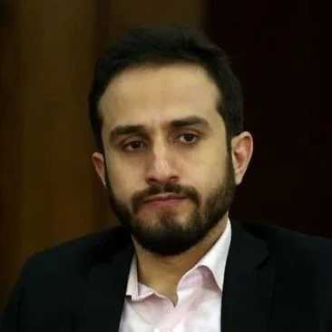

سواد مالی در وضع اقتصاد ما جزوی از واجباتی است که نداشتن‌اش باعث می‌شود که نون شب دسترسی‌ناپذیر بشود.

**[سکه](https://castbox.fm/channel/Sekke-Podcast-%7C-%D9%BE%D8%A7%D8%AF%DA%A9%D8%B3%D8%AA-%D8%B3%DA%A9%D9%87-id2394025)**

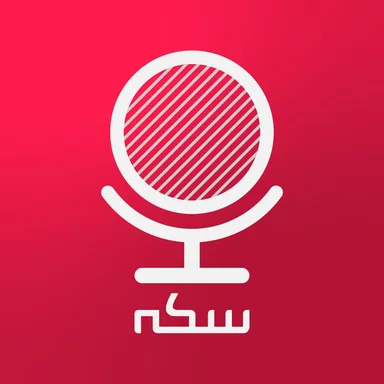

سکه شاید قدیمی‌ترین پادکست اقتصادی باشد و تا به الان با تعداد زیادی اقتصاددانان معروف ایرانی مصاحبه کردند.

**[فارکست](https://castbox.fm/channel/FarCast%7C%D9%81%D8%A7%D8%B1%DA%A9%D8%B3%D8%AA-id4584326)**

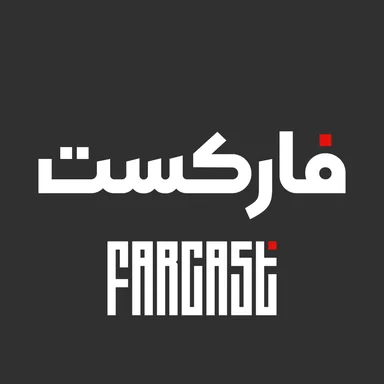

در این پادکست هر هفته چند مقاله را از هفته‌نامه اکونومیست انتخاب می‌کنند و با چند نفر از متخصصان‌شون تحلیل می‌کنند. مجله اکونومیست اگر نمی‌شناسید یکی از قدیمی‌ترین و مشهورترین مجله‌های اقتصادی‌سیاسی در دنیا است.

**[اینوست‌پلاس](https://castbox.fm/channel/%D8%A7%DB%8C%D9%86%D9%88%D8%B3%D8%AA-%D9%BE%D9%84%D8%A7%D8%B3-%7C-investplus-id2483543)**

اگر که به معامله‌گری و سرمایه‌گذاری علاقه‌مند هستید پادکست خوبی است. بعضی وقت‌ها با آدم‌های خوبی مصاحبه می‌کنند.

**[دوکراسی در کار](https://castbox.fm/channel/Democracy-DarKar-Plus-id1432965)**

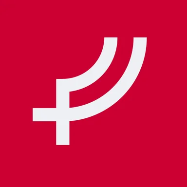

این پادکست سوسیالیست‌ها هستند. اپیزودهای اول‌شون جالب بود برای من ولی جدیداً اپیزودهاشون را دوست ندارم.

**[دایجستتت](https://castbox.fm/channel/Digesttt-%D9%BE%D8%A7%D8%AF%DA%A9%D8%B3%D8%AA-%D8%AF%D8%A7%DB%8C%D8%AC%D8%B3%D8%AA-id2038326)**

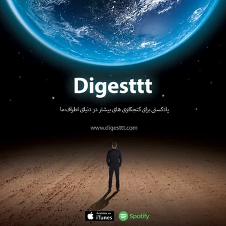

خیلی وقت است که دیگه اپیزود نمی‌گذارند اما مطالب‌شون برای داشتن آشنایی کلی با بعضی مسائل خوب است.

---

## پادکست‌های علمی

**[عصر حجر](https://castbox.fm/channel/%D8%B9%D8%B5%D8%B1-%D8%AD%D8%AC%D8%B1-id4922481?country=gb)**

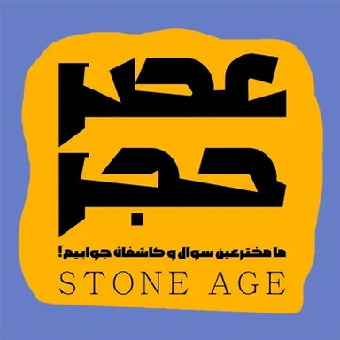

مسائل زیست‌شناسی تکاملی را با طنز و شوخی تعریف می‌کنند. برخی از مطالب‌شون مثبت ۱۸ است اما خودشون می‌گویند مثبت ۱۵. اگر یک اپیزودشون گوش بدید دیگه نمی‌تونید گوش ندید — ترجیحاً از اپیزود اول شروع کنید.

**[خداحافظ آفریقا](https://castbox.fm/channel/%D8%AE%D8%AF%D8%A7%D8%AD%D8%A7%D9%81%D8%B8-%D8%A2%D9%81%D8%B1%DB%8C%D9%82%D8%A7-id4997431?country=gb)**

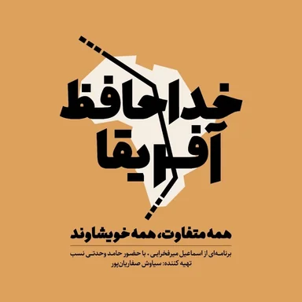

درباره انسان‌شناسی و سیر تکامل انسان و گونه‌های مختلف انسان‌ها صحبت می‌کنند.

**[استریگ‌کست](https://castbox.fm/channel/StringCast-%7C-%D8%A7%D8%B3%D8%AA%D8%B1%DB%8C%D9%86%DA%AF-%DA%A9%D8%B3%D8%AA-id5038897)**

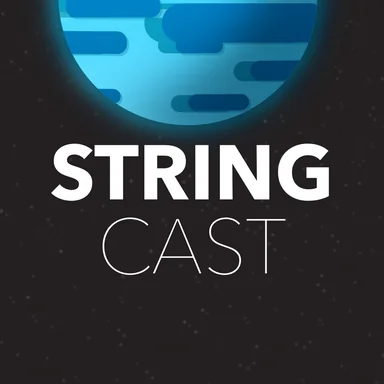

درباره فیزیک و کیهان‌شناسی صحبت می‌کنند.

---

## پادکست‌های تفننی

**[چنل‌بی](https://castbox.fm/channel/ChannelB-%D9%BE%D8%A7%D8%AF%DA%A9%D8%B3%D8%AA-%D9%81%D8%A7%D8%B1%D8%B3%DB%8C-id2356600)**

چنل‌بی شاید قدیمی‌ترین و مشهورترین پادکست فارسی‌زبان است. آقای علی بندری داستان‌های واقعی فوق‌العاده‌ای در این پادکست تعریف می‌کنند.

**[اسطوراخ](https://castbox.fm/channel/%D9%BE%D8%A7%D8%AF%DA%A9%D8%B3%D8%AA-%D8%B7%D9%86%D8%B2-%D8%A7%D8%B3%D8%B7%D9%88%D8%B1%D8%A7%D8%AE-id2889608)**

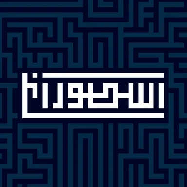

اسطوره‌های یونانی را با طنز تعریف می‌کنند. اپیزودهای اول‌شون که داستان خدایان معروف‌تر را تعریف می‌کنند خیلی جالب و خنده‌دار بود برای من.

**[فردوسی‌خوانی](https://castbox.fm/va/1452627)**

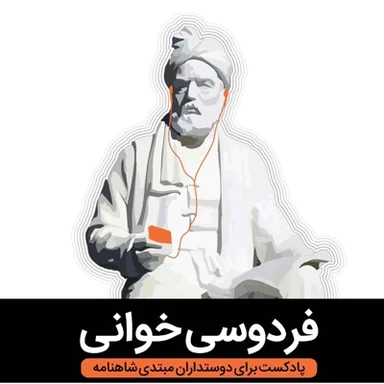

اگر شاهنامه دوست دارید پادکست جالبی است. من خودم خیلی گوش ندادم چون کلی باید فکر کنم که «الان اینکه الان گفت یعنی چی».

---

## مناظره و مصاحبه

**[پرگار BBC](https://castbox.fm/channel/%D9%BE%D8%B1%DA%AF%D8%A7%D8%B1-id574467?country=gb)**

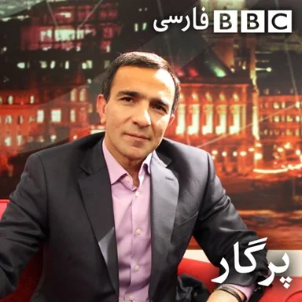

پرگار اصیل‌ترین برنامه مناظره فارسی‌زبان است. مجری برنامه آقای داریوش کریمی برای من واقعاً سمبل متانت و خوش‌صدا بودن است. چون تقریباً از ۲۰ سال پیش هر هفته گفت‌وگو جدید دارند برنامه‌ای نیست که بشنید از اول گوش بدید — موضوعاتی که علاقه‌مندید را می‌تونید گوش بدید.

**[آزاد](https://castbox.fm/channel/Azad-%7C-%D8%A2%D8%B2%D8%A7%D8%AF-id6025814)**

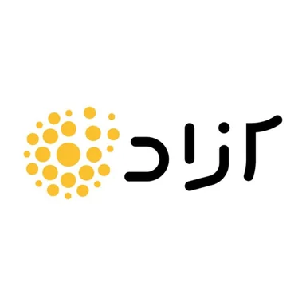

برنامه مناظره‌ای که یک یا دو سال است که شروع به کار کردند و مناظره‌های خوبی تا به الان ضبط کردند.

**[رادیو دال](https://castbox.fm/channel/%D8%B1%D8%A7%D8%AF%DB%8C%D9%88-%D8%AF%D8%A7%D9%84-%7C-Radio-Daal-id1210932)**

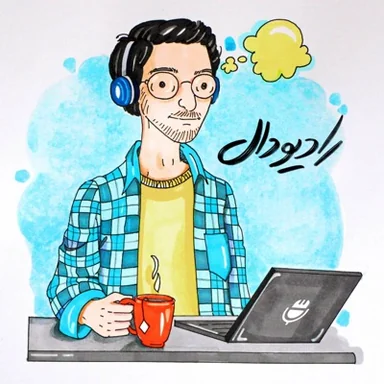

واقعاً پادکست دوست‌داشتنی است. داخل این پادکست با افرادی که به کشورهای مختلف مهاجرت کردند مصاحبه می‌کنند و از تجربیات زندگی‌شون می‌گویند.

**[طبقه ۱۶](https://castbox.fm/channel/Tabaghe-16-%D8%B7%D8%A8%D9%82%D9%87-id4906765)**

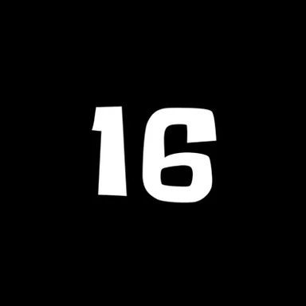

در این پادکست با کارآفرینان و افراد داخل استارتاپ‌های موفق مصاحبه می‌کنند.
