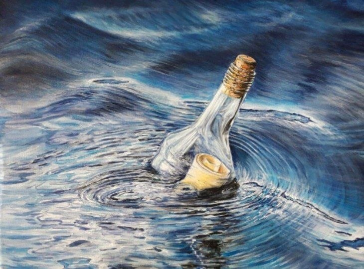
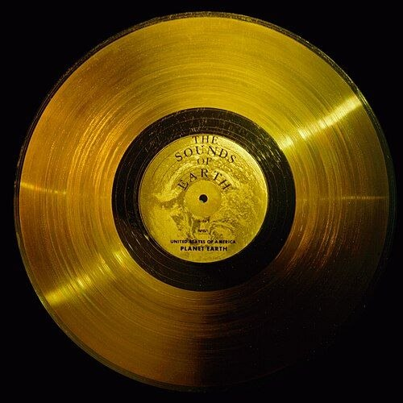
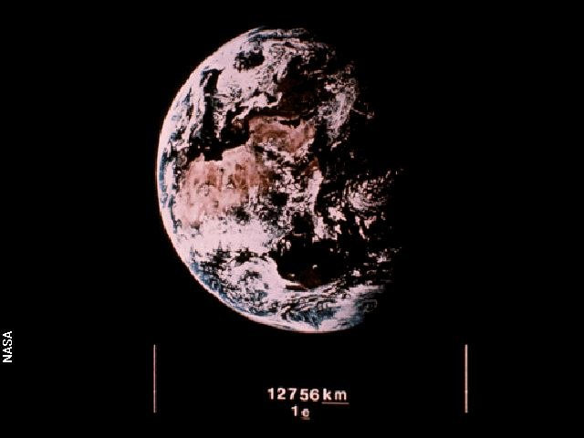
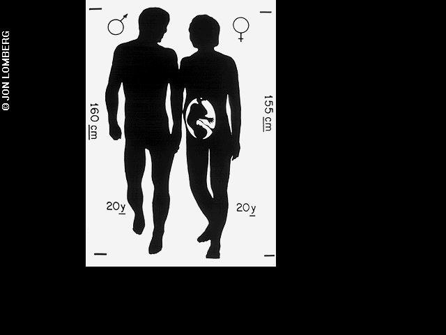
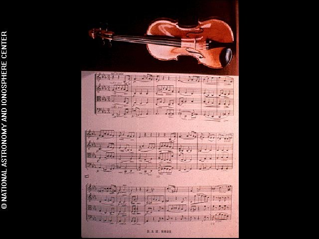
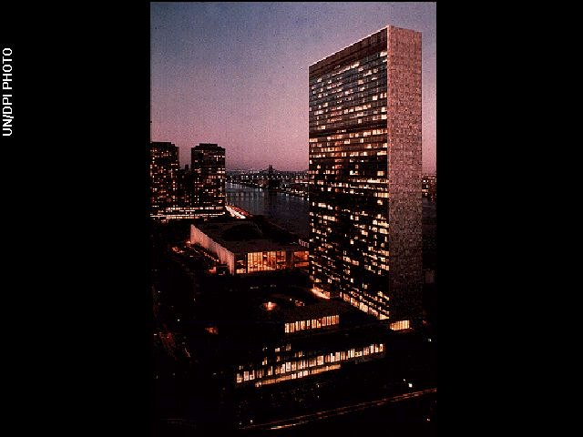
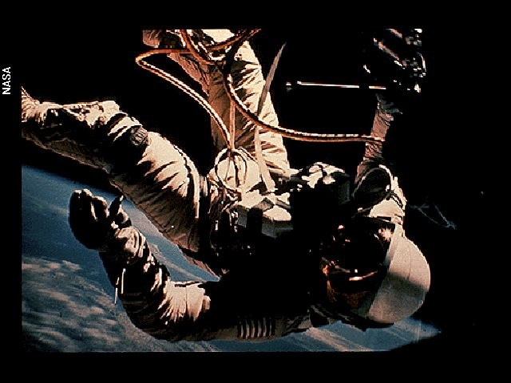

این نوشته را هوش مصنوعی از [کانال تلگرام](https://t.me/roznevesht_parsa_rajaei) به وبلاگ منتقل کرده است و متن آن بدون ویرایش منتشر شده است.

این چند روز داشتم ضبط‌های طلایی ویجر گوش میدادم. میخواستم چندتا از آهنگ‌هاشو براتون بزارم که گفتم اگر اول پیش زمینه‌اش تعریف کنم بعد برم سراغ آهنگ‌هاش فشنگ‌تر میشه.

ویجر ۱ و ۲ فضاپیماهایی بودند که ناسا‌ سال ۱۹۷۷ به فضا پرتاب کرد تا از زحل و مشتری عکس برداری کنند. چون سفینه‌ها بعد از اتمام ماموریت‌شان از منظومه شمسی خارج می‌شدند صفحه گرامافونی از جنس طلا روی این سفینه‌ها گذاشتند که اگر بعد از خارج شدن از منظومه شمسی چند میلیارد سال بعد به دست تمدن فضایی افتادند آنها صدا و تصویری از گونه انسان و سیاره زمین یادگار داشته باشند. کاری مشابه انداختن بطری با نامه به دریا.

محتوای صفحه گرامافون عکس‌هایی از سیاره زمین، سلام و احوال پرسی به ۵۵ زبان مختلف، ۹۰ دقیقه موسیقی و صداهای مختلف از سیاره زمین مثل صدای حیوا‌ن‌های مختلف، صدای موج یا صدای گریه بچه بود.

یک تعدادی از عکس‌هایی که روش رمزنگاری کردند.

<video controls playsinline preload="metadata" style="max-width:100%;height:auto" src="249.mp4"></video>

صدای بچه‌‌ای که مادرش داره آرومش میکنه

<video controls playsinline preload="metadata" style="max-width:100%;height:auto" src="251.mp4"></video>

مورد جالبی که درباره بخش سلام کردن  متوجه‌ شدم اینکه زبان فارسیش از همه طولانی‌‌تره بقیه زبان‌ها ۳ یا ۴ ثانیه نهایت فقط سلام احوال پرسی می‌کنن ولی زبان فارسی داخلش ۱۲ ثانیه شعر خوانده میشه.
و خوب واقعا هم شعر قشنگیه لیاقت اینکه برای نمایندگی بشر فرستاده بشه را داره.

و البته بخش اصلی این پروژه برای نمایش تمدن بشر ۹۰ دقیقه موسیقی‌ای بود که از فرهنگ‌های مختلف روی این صفحه ضبط کردند. موسیقی که تصمیم گرفتند با آن شروع کنند یکی از کنسرتو براندنبورگ‌های(Brandenburg Concerto) باخ است.
و یک موردی اینکه من خودم هم به تقلید از اینها اولین آهنگی که در پروفایل تلگرامم گذاشته بودم یکی از کنسرتو براندنبورگ‌های باخ بود. فقط من شماره یکش را گذاشتم.

[Brandenburg Concerto No. 2 in F Major, BWV 1047: I. Allegro](https://www.youtube.com/watch?v=olLi5RtE_6M)



یک موضوع دیگه اینکه احتمالی که این ضبط‌ها به دست فضایی‌ها برسه یکم بیشتر از صفره ولی صفر نیست. این کار بیشتر برای انسا‌ن‌هاست اینکه بلاخره ما چند هزار سال یک تمدنی درست کردیم تاریخی داریم یک سیاره‌ای داریم همه اینها را اگر بخوایم از دید یک فضایی ببینیم کار جالبیه.

https://youtube.com/playlist?list=PL3lxrIznkXXYS1K0PJ5_sou2QdE06Msve&si=8oEd2-uenrfwSv2F

پلی لیست کامل موسیقی‌های ویجر
تنوع خیلی جالبی داره.
یک چندتاشو میزارم.

[Voyager's Golden Record - Iziel je Delyo Hagdutin - Bulgaria](https://www.youtube.com/watch?v=ZP29VyGOLnw)



میخواستم ازش تعریف کنم یاد یک نقل قولی افتادم که جدیدا شنیدم

> ...هیچ کس زمان تماشا غروب آفتاب دست نمی‌زند

[Voyager's Golden Record - Johnny B  Goode - Chuck Berry](https://www.youtube.com/watch?v=Qz126SNxAts)



این هم جالبه بود برام
پنجم‌های موازی که داخلش می‌خوانند در اکثر موسیقی‌هایی که می‌شنویم غیر قانونیه

پنجم موازی هم خیلی خلاصه یعنی دوتا صدا که از هم پنج تا فاصله دارند بروند به دو نت دیگه که اون ها هم پنج‌تا از هم فاصله دارند.

[Voyager's Golden Record - Tchakrulo - Choir - Georgia](https://www.youtube.com/watch?v=bV85zrndvdY)


