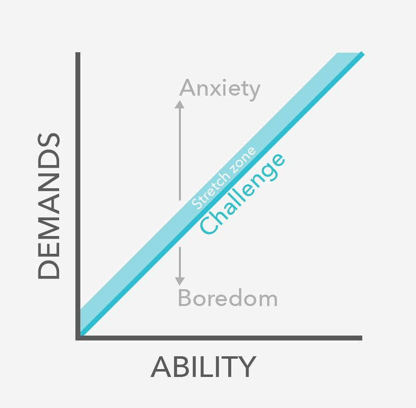
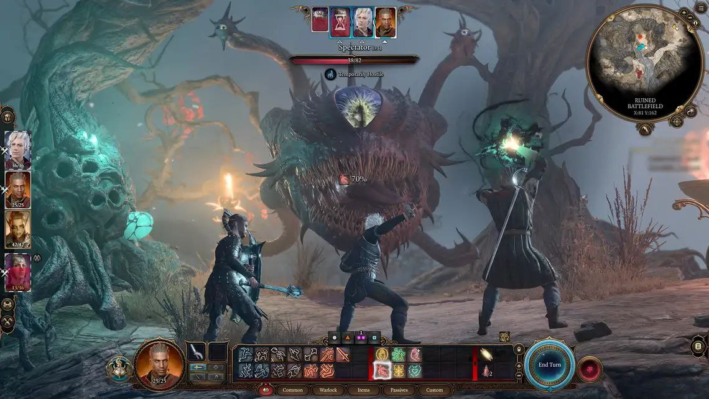
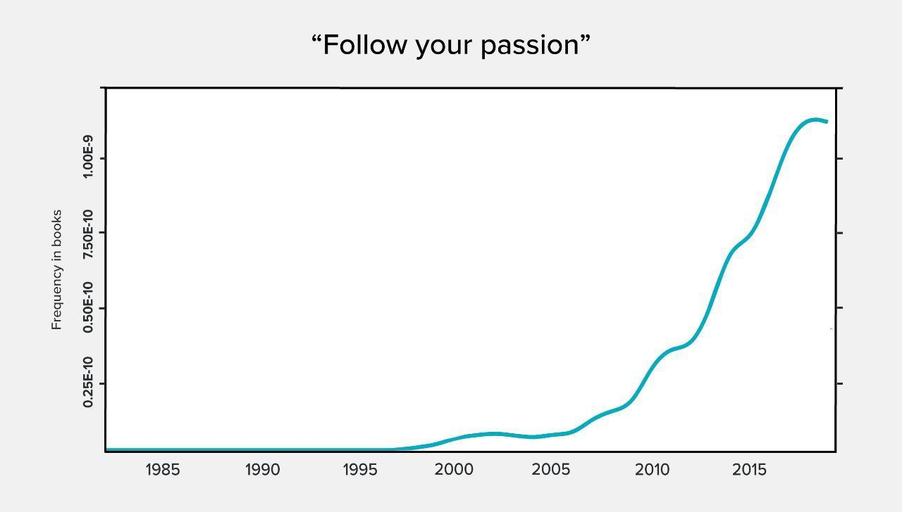
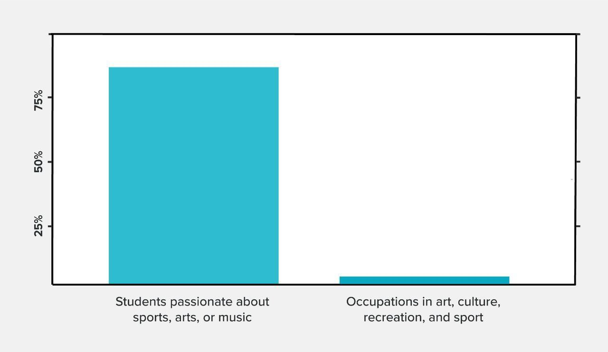

در بالا دو محور میزان توانایی و میزان سختی کار را می‌توانید مشاهده کنید. سختی بیش از حد یک مسئولیت باعث اضطراب و راحتی بیش از حداش باعث بی‌حوصله‌گی می‌شود. در این بین مرز باریکی وجود دارد که در اینجا آن را چالش اسم گذاشتند — اما در کتاب‌ها و مطالب خودیاری دیدم که به این موضوع *flow* یا غرقه هم می‌گویند.

حالا که نه پول و نه کار بدون استرس باعث رضایت شغلی می‌شود، بالاخره ویژگی‌های یک شغل خوب چیست؟ مقاله ۶ عامل را برای یک شغل رویایی اسم می‌برد.

**کاری که درگیر کننده (Engaging) باشد**

نه پول نه مزایای یک کار باعث رضایت شغلی نمی‌شود بلکه محتوای کاری است که شما در زمان کار انجام می‌دهید. محتوای کار است که باعث می‌شود شما به کار ادامه بدهید، بی‌حوصله نشید و حقوق پایین را تحمل کنید (نه حقوق خیلی پایین). بازی‌های کامپیوتری نمونه بسیار خوبی از یک کار درگیر کننده و جذاب هستند. کاری درگیر کننده است که ویژگی‌های زیر را داشته باشد:

1. آزادی در نحوه انجام فعالیت
2. وظایف شفاف و مشخص
3. تنوع در وظایف
4. بازخورددهی برای اینکه بفهمید کار چقدر خوب انجام می‌دهید

نتایج تحقیقات نشان می‌دهد که هر کدام از عوامل بالا همبستگی با رضایت شغلی دارند (r=0.4).

با این وجود بازی‌های کامپیوتری کلید یک زندگی رضایت‌بخش نیستند (نه فقط چون پول برای بازی کردن نمی‌دهند). چون شما احتیاج به چیز دیگری دارید...

**کاری که به دیگران کمک می‌کند**

مشاغلی که افراد در آنها خیری به بشر نمی‌رسانند بیشتر کار خود را بی‌معنی توصیف می‌کنند. مثلاً طراحان مد و یا کارگردانان برنامه‌های خبری ویژگی‌های شغل درگیر کننده را دارند اما از شغل خود راضی نیستند چون احساس می‌کنند کارشان بی‌معنی است. اما در عوض پرستارها و جراحان مغز و اعصاب بیشتر کار خودشان را معنی‌دار می‌دانستند و رضایت شغلی بیشتری داشتند.

تحقیق دیگری نشان می‌دهد که در سراسر دنیا افرادی که به خیریه کمک می‌کنند رضایت‌شان از زندگی معادل افرادی با درآمد دوبرابر آنها است.

**کاری که در آن خوب هستید**

مهارت در کار باعث احساس توانمندی در افراد می‌شود. همچنین فردی که در کاری تبحر دارد قدرت چانه‌زنی بیشتری در سایر عوامل یک شغل خوب را دارد. مثلاً می‌تواند پروژه‌هایی را انتخاب کند که برایش معنی‌دار هستند.

خوب بودن در کاری، باعث علاقه‌مند شدن به کار می‌شود. اما برعکس این‌شکلی کار نمی‌کند — مثلاً اگر عاشق هنر و طراحی باشید و استعدادی در آن نداشته باشید، در نهایت یک کار گرافیکی خسته‌کننده برای شرکتی که اهمیتی برای شما ندارد را باید انجام دهید.

اما این به این معنی نیست که حتماً باید کاری که همین الان در آن خوب هستید انجام دهید. یعنی باید حداقل پتانسیل این را داشته باشید که در آن کار مهارت پیدا کنید.

**کاری با همکاران حمایت‌گر**

تحقیقات نشان می‌دهد که داشتن همکارانی که شبیه شما هستند و یا در مشکلات به شما کمک می‌کنند بخش خیلی مهمی از یک کار رضایت‌بخش است. این ویژگی ضریب همبستگی خیلی قابل توجهی با رضایت شغلی دارد (r=0.56).

ضریب همبستگی ۱ بین دو متغیر یعنی دو متغیر یک متغیر هستند. ۰.۵۶ یعنی در بیشتر از نصف مواقع افرادی که همکاران خوبی دارند از شغل‌شون راضی هستند.

**کاری که متناسب با بقیه زندگی شماست**

شغل حتماً نباید شامل همه موارد بالا باشد. ممکن است کاری داشته باشید که فقط از آن امرارمعاش می‌کنید اما کارهای جانبی که انجام می‌دهید برایتان معنی‌دار هستند. یک مثال خیلی معروف می‌تواند انیشتین در سال ۱۹۰۵ باشد — که یک کارمند ساده دفتر ثبت اختراع بود اما در آن سال چند شاخه جدید در علم فیزیک ایجاد کرد.

---

**درنهایت شش ماده تشکیل‌دهنده شغل رضایت‌بخش عبارتند از:**

1. کار درگیرکننده که به حالت غرقه‌گی وارد می‌شوید (آزادی، تنوع، وظایف شفاف، بازخورد)
2. کاری که به دیگران کمک می‌کند
3. کاری که در آن خوب هستید
4. همکاران حمایت‌گر
5. نبود موارد منفی قابل‌توجه، مثلاً ساعت‌های کاری خیلی طولانی یا حقوق غیرمنصفانه
6. متناسب با بقیه زندگی

**آیا باید علاقه‌مون را دنبال کنیم؟**

«علاقه‌ات را دنبال کن» جمله تکراری که این روزها زیاد می‌شنویم. این جمله دو مشکل دارد.

مورد اول اینکه اگر کار مورد علاقه‌تان هیچ‌کدام از ۶ مورد بالا را نداشته باشد شغل رضایت‌بخشی نخواهید داشت. و دنبال کردن علاقه اتفاقاً باعث می‌شود که سخت‌تر به موارد بالا دست پیدا کنید، چون کار مورد علاقه افراد احتمالاً در حوزه بسیار رقابتی قرار دارد.

دوم اینکه باعث می‌شود افراد گزینه‌هاشون را محدود کنند. خیلی راحت یک فرد می‌تونه تصمیم بگیره که به ادبیات علاقه‌منده و تمامی گزینه‌های دیگه‌اش را نادیده بگیرد فقط به خاطر اینکه آن گزینه‌ها در آن لحظه برایش رضایت‌بخش نبودند.

اما در سوی دیگر شما به یک کار علاقه‌مند می‌شوید اگر که به دیگران کمک کنید یا با تمرین در کارتان مهارت پیدا کنید، مسئولیت‌های درگیر کننده داشته باشید یا با آدم‌هایی کار کنید که آنها را دوست دارید. به جای اینکه علاقه‌ای داشته باشید که در طول زمان ممکن است تغییر کند.

---

نتیجه این مطلب طولانی:

مهارت پیدا کردن در کاری که برای دیگران ارزشمند است باعث می‌شود که فرصت‌های شغلی زیادی داشته باشید و بتونید روی بقیه مزایای یک شغل خوب بهتر چانه بزنید. خلاصه اکثر ویژگی‌های یک شغل خوب می‌تونید داشته باشید اگر فقط در کار مهارت داشته باشید.

اما یک ویژگی کار هست که باید جدا در نظر گرفته بشود چون با مهارت خالی بدست نمی‌آید و آن کمک کردن به دیگران است. آدام گرنت در کتاب [بده و بستان](https://taaghche.com/book/80746/%D8%A8%D8%AF%D9%87-%D9%88-%D8%A8%D8%B3%D8%AA%D8%A7%D9%86%D8%9B-%D8%B1%D9%88%DB%8C%DA%A9%D8%B1%D8%AF%DB%8C-%D8%A7%D9%86%D9%82%D9%84%D8%A7%D8%A8%DB%8C-%D8%A8%D9%87-%D9%85%D9%88%D9%81%D9%82%DB%8C%D8%AA) که به فارسی هم ترجمه شده توضیح می‌دهد که اگر وظیفه خودتون را این بدونید که به دیگران کمک کنید، اول دیگران به شما کمک می‌کنند که موفق بشید و بعد انگیزه‌ای که از کمک کردن بدست می‌آورید باعث می‌شود که بیشتر تلاش کنید.

با این وجود اگر که کار شما فقط کمک کردن باشد این به مرور باعث فرسودگی شغلی می‌شود، پس کار باید پنج مورد دیگر که بالا ذکر شد را هم داشته باشد.

**نتیجه نهایی:**  
برای داشتن شغل رویایی خیلی نباید نگران پول و یا پیدا کردن یکتا علاقه ابدی بود. بلکه باید به دنبال مهارت و کاری بود که متناسب برای شما و مفید برای دنیا باشد.

به طور کلی اگر بخوایم مثل جمله کلیشه‌ای «علاقه‌ات را دنبال کن» کل مطلب را در یک جمله خلاصه کنیم آن جمله می‌شود:

> **«در کاری مهارت پیدا کن که به دیگران کمک می‌کند.»**

---

این نوشته را هوش مصنوعی از [کانال تلگرام](https://t.me/roznevesht_parsa_rajaei) به وبلاگ منتقل کرده است و متن آن بدون ویرایش منتشر شده است.

**نوشته‌های این مجموعه**

1. [درآمد و شادی]()
2. [بودیسم و خوشبختی]()
3. **ویژگی‌های یک شغل رویایی**
